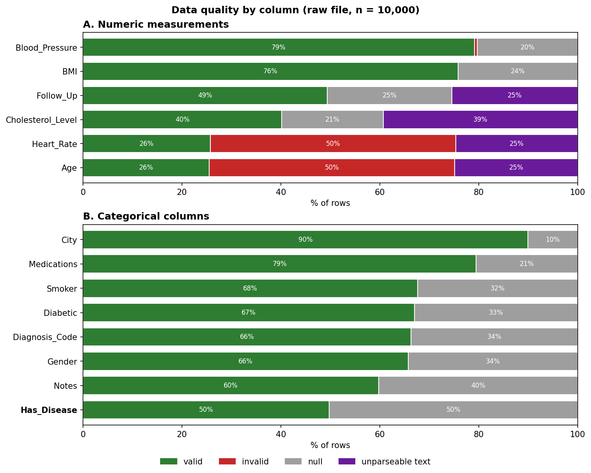
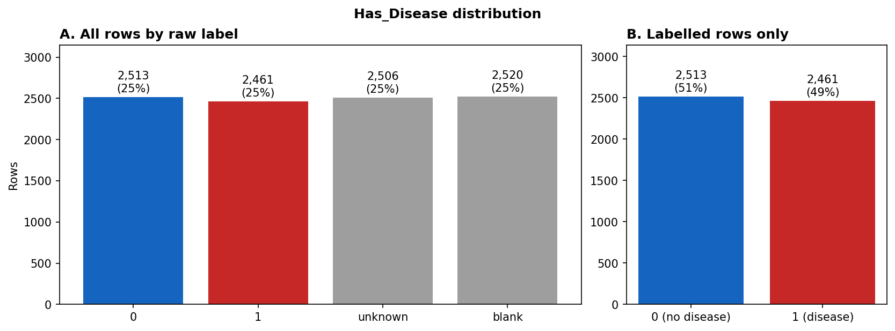
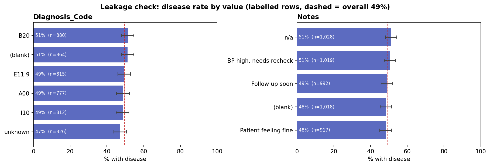
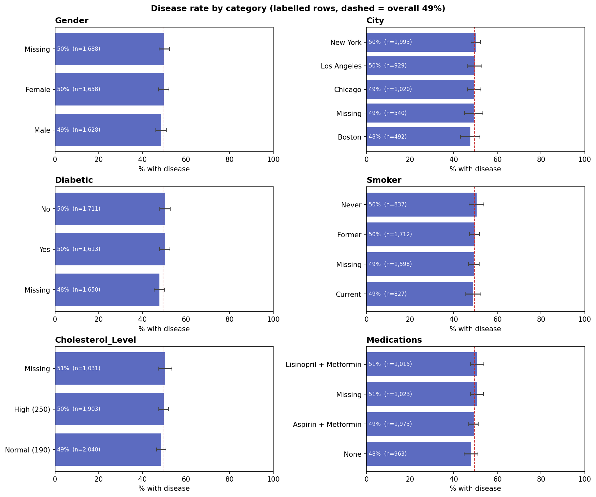

# Health Disease Prediction

## 1. Project overview

This project builds a reproducible machine learning pipeline that predicts whether a patient has a disease (`Has_Disease`) from raw patient health records. It covers data-quality analysis, rule-based cleaning, leakage-safe encoding and scaling, a comparison of four classifiers, and an inference workflow that scores new raw records. Experiments are tracked in Weights & Biases. The same logic is packaged as a Python library with a CLI and three Airflow DAGs, so the whole pipeline can run automatically.

## 2. Problem statement

- **Objective:** binary classification of `Has_Disease` (1 = disease, 0 = no disease).
- **Output:** for each patient, a predicted class and a probability of disease.
- **Data:** [Patient Health Record – Raw CSV (Kaggle)](https://www.kaggle.com/datasets/mursaleen880/patient-health-record-raw-csv), 10,000 rows × 17 columns.
- **Which file:** the raw file is used rather than the provided "clean" file. That file was scaled and encoded on the full dataset before any split, which leaks test information. Cleaning from raw keeps every transformation under our control.

## 3. Repository structure

```
health-disease-prediction/
├── README.md
├── config.yml                  # data paths, features, model settings and versions, W&B, best model
├── pyproject.toml / uv.lock    # dependencies (uv)
├── .env.example                # W&B credentials template (copy to .env)
├── notebooks/
│   ├── 01_visualization.ipynb  # EDA, data quality, 4 figures
│   ├── 02_preprocessing.ipynb  # cleaning rules -> cleaned dataset
│   ├── 03_training.ipynb       # split, encoding, 4 models, W&B, model selection
│   └── 04_inference.ipynb      # synthetic records -> predictions
├── src/health_disease_prediction/   # the notebooks' logic as a reusable package
│   ├── preprocessing.py  features.py  training.py  inference.py
│   ├── config.py  cli.py  orchestration.py
├── dags/                       # Airflow DAGs: preprocessing, training, inference
├── tests/                      # pytest unit tests
├── data/                       # raw, processed, synthetic data (not committed, see data/README.md)
├── artifacts/                  # versioned encoders, fill values and models (*_v1.*)
└── reports/
    ├── figures/                # EDA figures
    ├── model_comparison.csv
    ├── synthetic_predictions.csv
    └── README.md               # full figure legends and interpretations
```

## 4. Methodology

### 4.1 Exploratory data analysis
Each column was classified as **valid / invalid / null / unparseable text** against clinical ranges. The analysis also covered the target distribution, a leakage check and the disease rate by category with 95% confidence intervals (see section 5).

### 4.2 Preprocessing
Rows without a confirmed 0/1 label are dropped, leaving **4,974 of 10,000** rows. Each column is then cleaned with explicit rules:

| Column | Cleaning rule | Missing filled with |
|---|---|---|
| Age | words to numbers (`twenty` → 20); values > 120 divided by 10 (`250` → 25); negatives → missing | mode |
| Gender | `male`/`M` → M, `FEMALE`/`F` → F | mode |
| City | merge variants (`NY`, `newyork`, `Nwe Yrok` → New York; `la` → Los Angeles) | mode |
| BMI | strip `kg/m2` | mean |
| Blood_Pressure | `120 over 80`, `120 - 80` → `120/80` | mode |
| Heart_Rate | keep 40–180 bpm; `0`, `500`, words → missing | median |
| Cholesterol_Level | `high` → 250, `normal` → 125, `low` → 100 | mode |
| Diabetic / Smoker | yes/no variants → `Y`/`N`; smoker `EX-smoker`/`Former` → `Ex` | mode |
| Medications | unify separators (`;`, `/` → `,`) | `none` |
| Follow_Up | days as numbers; `two weeks` → missing | mode |
| Diagnosis_Code / Notes | placeholders → missing | `Unknown` / `No Notes` |
| Last_Visit_Date | four date formats parsed (slash dates are dd/mm/yyyy) | mode |

Patient_ID gaps are rebuilt from row order. Patient_ID, Name and Last_Visit_Date are not used as model features.

### 4.3 Splitting
A stratified 80/20 train/test split with a fixed seed (42) gives **3,979 training and 995 test rows**, with the same class balance in both.

### 4.4 Encoding and scaling
All encoders are fitted on the **training split only** and reused unchanged on test and inference data, producing 29 model features.

| Features | Method | Why |
|---|---|---|
| Gender, City, Medications, Diagnosis_Code, Notes, Smoker, Diabetic | One-hot | nominal categories; unseen values become all zeros |
| Blood_Pressure | Frequency encoding | ~700 distinct readings, too many for one-hot |
| Follow_Up | Ordinal (14 → 0, 30 → 1) | two ordered values |
| Age, BMI, Heart_Rate, Cholesterol_Level | Standard scaling | puts features on one scale for SVM and logistic regression |

### 4.5 Algorithms
Random Forest, Logistic Regression, SVM (RBF kernel) and XGBoost. Their parameters and versions (currently `1.0.1`) are set in `config.yml`.

### 4.6 Cross-validation and tuning
Not yet implemented. Models are trained once with fixed parameters and compared on the holdout test set (see section 9).

### 4.7 Metrics and model selection
Accuracy, precision, recall, F1 and ROC-AUC are computed on **both train and test**, so overfitting is visible. Every model's run, metrics and confusion matrix are logged to W&B. The model with the highest `test_roc_auc` is written to `config.yml` as the best model.

### 4.8 Inference
New raw records go through the same cleaning rules, are filled with the values saved during preprocessing, and are encoded with the saved encoders. The best model named in `config.yml` then scores them. As a demonstration, 25 synthetic records are generated by sampling the raw columns, so they keep the original messy formats.

### 4.9 Reproducibility and automation
- **Everything in one config:** paths, features, model settings and versions live in `config.yml`.
- **Versioned artifacts:** the files are `fill_values_v1.json`, `preprocessors_v1.joblib` and `models_v1.joblib`, and inference checks the model version against the config.
- **Fixed seeds:** all random steps use the same seed.
- **Experiment tracking:** every run is logged to W&B.
- **Automation:** the notebooks' logic is packaged in `src/` and runs either from the `hdp` command or from three Airflow DAGs linked by data assets: preprocessing → training → inference.

## 5. Visualizations and interpretations

Full legends are in [reports/README.md](reports/README.md).

### 5.1 Data quality overview

- Age and Heart_Rate are only about 26% valid. The rest are impossible placeholder values (`-5`, `250`, `0`, `500`) or words.
- No column is more than 90% valid, so cleaning and imputation decide what the model sees.

### 5.2 Target distribution

- 50% of labels are `unknown` or blank and cannot be used for training.
- The labelled classes are balanced (51% / 49%), so no resampling is needed. The baseline to beat is about 51% accuracy.

### 5.3 Leakage check

- Every `Diagnosis_Code` and `Notes` value has a disease rate of 47–51%, so **no leakage** was found.
- In a real deployment these fields are recorded after diagnosis. They would not be available at prediction time, so they should be excluded.

### 5.4 Disease rate by category

- Every category, including missing values, sits at 48–51%, within the confidence interval of the overall 49%.
- Even clinically expected risk factors (smoking, diabetes, high cholesterol) show no effect, so expect near-chance model performance.

## 6. Results summary

### 6.1 Model comparison (holdout test set, n = 995)
| Model | Train accuracy | Test accuracy | Test precision | Test recall | Test F1 | Test ROC-AUC |
|---|---|---|---|---|---|---|
| **Random Forest** | 0.873 | **0.515** | 0.510 | 0.461 | 0.485 | **0.521** |
| Logistic Regression | 0.515 | 0.486 | 0.478 | 0.423 | 0.449 | 0.484 |
| SVM | 0.673 | 0.503 | 0.497 | 0.494 | 0.495 | 0.492 |
| XGBoost | 0.783 | 0.502 | 0.496 | 0.482 | 0.489 | 0.494 |
| *Majority-class baseline* | – | *0.506* | – | – | – | *0.500* |

Source: [reports/model_comparison.csv](reports/model_comparison.csv).

### 6.2 Selected model
**Random Forest v1.0.1** (highest test ROC-AUC): 350 trees, max depth 15, at least 5 samples per leaf.

### 6.3 Confusion matrix (Random Forest, test set)
| | Predicted no disease | Predicted disease |
|---|---|---|
| **Actual no disease** (503) | 285 (true negative) | 218 (false positive) |
| **Actual disease** (492) | 265 (false negative) | 227 (true positive) |

### 6.4 Variability across folds
Not available yet, because cross-validation has not been implemented (see section 9).

## 7. Interpretation of results

- **Performance is at chance level.** The best test accuracy (51.5%) is within one percentage point of always predicting "no disease" (50.6%), and ROC-AUC (0.52) is close to random guessing (0.50). This matches the EDA, where no feature separated the classes.
- **The tree models overfit.** Random Forest and XGBoost reach 87% and 78% training accuracy but only about 50% on test, so they are memorising noise. Logistic Regression's similar train and test scores show there is little real signal to learn.
- **Key error:** the model misses **54% of patients who have the disease** (265 of 492 are false negatives). For a disease model, missed cases are usually the most costly error.
- **Class trade-off:** lowering the decision threshold below 0.5 would catch more sick patients (higher recall) at the cost of more false alarms (lower precision). With no underlying signal, this only moves errors between the two classes; it doesn't reduce them.
- **The selection is optimistic.** The best model is picked on the same test set that reports its score. With all four models within ±3 points of 0.5, the "winner" is mostly chance.
- **Deployment caution:** the model **must not be used for clinical decisions**. Its predictions carry no more information than a coin flip, and the synthetic-test probabilities (0.36–0.59) show it is never confident.

## 8. Reproduction instructions

### 8.1 Environment
```bash
git clone <repo-url> && cd health-disease-prediction
uv sync                       # creates .venv with locked dependencies (Python 3.10)
cp .env.example .env          # add WANDB_API_KEY (and optionally WANDB_ENTITY)
```
To run without W&B, set `wandb.mode: disabled` in `config.yml`.

### 8.2 Option A: notebooks (exploration)
Open the notebooks with the `.venv` kernel and run them in order. Each step downloads or reads the previous step's outputs.

| Order | Notebook | Produces |
|---|---|---|
| 1 | `01_visualization.ipynb` | `data/Patient_Health_Records_Raw.csv`, `reports/figures/*.png` |
| 2 | `02_preprocessing.ipynb` | `data/processed/Cleaned_Health_Records.csv` |
| 3 | `03_training.ipynb` | `artifacts/encoders/`, `artifacts/models/`, `reports/model_comparison.csv`, best model in `config.yml` |
| 4 | `04_inference.ipynb` | `data/synthetic/Synthetic_Test_Data.csv`, predictions |

### 8.3 Option B: command line (same results as the notebooks)
```bash
uv run hdp preprocess    # download (if missing), clean, validate, save fill values
uv run hdp train         # split, fit encoders, train 4 models, compare, select best
uv run hdp predict       # generate synthetic records and save reports/synthetic_predictions.csv
uv run hdp all           # all three stages in sequence
```

### 8.4 Option C: Airflow
Trigger `health_preprocessing`; training and inference run automatically when their inputs update. Setup instructions are in [dags/README.md](dags/README.md).

### 8.5 Tests
```bash
uv run pytest
```

## 9. Assumptions and limitations

### Assumptions
- **Unlabelled rows:** rows with `unknown` or blank labels are assumed to be missing at random, so dropping them doesn't bias the training data.
- **Ages over 120** are assumed to be data-entry errors with an extra digit (`250` → 25).
- **Text cholesterol labels** are mapped to typical values: `normal` → 125, `high` → 250, `low` → 100 mg/dL.
- **Heart rates outside 40–180 bpm** are assumed to be recording errors.
- **Missing medication** means no medication (`none`).
- **Slash dates** are day-first (dd/mm/yyyy), because no value has a second part above 12.

### Limitations
- **Heavy imputation:** about 75% of Heart_Rate and about 50% of Follow_Up values are filled with a single value, so these features carry little information.
- **Fill values come from all labelled rows.** The mode, mean and median used to fill gaps are computed before the train/test split, so test rows have a small influence on them.
- **No cross-validation or tuning yet**, so there is no fold variability and parameters are not optimised. Model selection uses the test set; a selection based on cross-validation would be more reliable.
- **The data looks synthetic:** values repeat (e.g. `120/80` in about 60% of rows) and the target is unrelated to clinical risk factors. Results would not carry over to real patients.
- **Artifacts depend on library versions.** Models trained inside Airflow were pickled with `dill` loaded, and they need matching library versions to load elsewhere.
- **Cleaning rules are duplicated:** they exist in notebooks 02 and 04 as well as in `src/`, so a change must be made in all three places.
